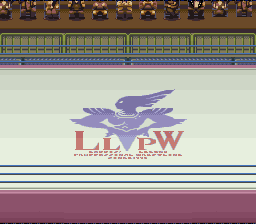
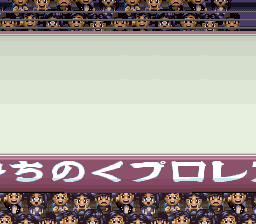
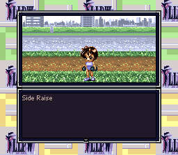
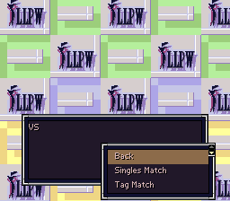
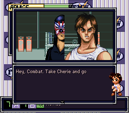

# Hidden content

Unlockables, debug features, button codes, cut and unused content. Every find says how sure it
is:

- *verified in game* - seen by the owner in an emulator (with the date, and the build or code used to get there)
- *seen headless* - seen in an automated emulator run, not yet checked by hand
- *from the code* - read in the disassembly, not seen running
- *from the data* - in the game's files or tables, whether or not the code uses it
- *from a guide* / *from fans* - a published source, not yet matched with the code

Addresses: CPU addresses `$bank:addr` (LoROM), file offsets of the original 1.5 MB image as `0x...`.
"Held" buttons mean exactly those buttons on controller 1 and nothing else. Optional patches that
switch some of this on are in [PATCHES.md](PATCHES.md).

**Prior art (2026-11-12).** Nothing published was found. Japanese and English Wikipedia, the
console and wrestling-game databases, Japanese strategy pages and blogs describe only the normal game
(story, versus mode with saved characters, the two endings). No Pro Action Replay or Game Genie codes
were found. The Cutting Room Floor, GameFAQs, GameHacking.org and two Japanese wikis refused automated
access, so they were not read. Everything below is new as far as we know.

## Contents
- [Match test at power-on (Up+R)](#match-test-at-power-on-upr)
- [Ring background viewer (Up+L)](#ring-background-viewer-upl)
- [Training animation viewer (unused)](#training-animation-viewer-unused)
- [Versus mode in the middle of the story (Select+X)](#versus-mode-in-the-middle-of-the-story-selectx)
- [End a match at once (Y+Down+R)](#end-a-match-at-once-ydownr)
- [Keep a foreign save (Select at power-on)](#keep-a-foreign-save-select-at-power-on)
- [A dead check on the match result screen](#a-dead-check-on-the-match-result-screen)
- [The cut JWWF exchange (FMW route)](#the-cut-jwwf-exchange-fmw-route)
- [Scenes no event plays](#scenes-no-event-plays)
- [Wrestlers never booked](#wrestlers-never-booked)
- [Searched and not found](#searched-and-not-found) · [How to see it yourself](#how-to-see-it-yourself)

## Match test at power-on (Up+R)
*seen headless* (2026-11-12, Mesen, original and English test builds)

Hold **Up+R** while the game starts. The title and story are skipped, and the game goes straight
into an automatic match in the LLPW ring. The boot code (`$04:83C7`) runs event `0xFFFF`, which sets
every heroine stat to 200 and books a match against Crusher Maedomari for "day 1" (the calendar shows
no date). After the match it runs the event again, so matches repeat until the console is reset.
It's a developer's match tester.

## Ring background viewer (Up+L)
*seen headless* (2026-11-12, Mesen, original and English test builds)

Hold **Up+L** while the game starts (`$07:D9DE`, in the title routine). Instead of the title, the
ring and crowd background is shown on its own. The d-pad scrolls it, and **Y** jumps along it. It
holds the LLPW, FMW and Michinoku Pro apron logos. Michinoku Pro matches are part of the normal
story, so the viewer shows no cut arena.

## Training animation viewer (unused)
*seen headless* (2026-11-12, Mesen, `build.py --unlocks dev-anim-viewer`)

A routine at `$04:FA62` (about 1 KB) that nothing in the game calls or points to. It shows the
riverbank training screen and plays each exercise animation with its name: Side Raise, Push-ups,
Front Raise, Rope Climbing, Bridge, Cable Crunch, Sit-ups, Punch, Hindu Squats, Jump Rope, Kicks,
Aerobics, Sparring, Falls, Abdominal Tap, Running, then back to the start. **A** moves to the next
one once the current animation has finished. All 16 exercises are in the normal game, so it shows no
cut exercise. It's an animation test the developers left in. The original has no way to reach it.
The optional patch `dev-anim-viewer` opens it when **Down+L** is held at power-on.

## Versus mode in the middle of the story (Select+X)
*seen headless* (2026-11-12, Mesen, English test build with the check forced on)

At the turn of every month, after the month counter moves on, the story loop waits half a second.
Then it checks for **Select+X** held (`$04:8666`) and, if so, opens the title screen's Versus mode
(`$07:BC04`). Back returns to the story. It uses the same saved wrestler banks as the Versus mode
from the title, so the heroine in progress can't be used. The only use is a quick versus match
without going back to the title.

## End a match at once (Y+Down+R)
*seen headless* (2026-11-12, Mesen, during the Up+R match test)

The match loop checks for **Y+Down+R** held once a turn (`$06:F01C`). If it's held, the match ends
after the current turn, and the side that made the last move wins (`$06:F210`), so it isn't an
automatic win for the heroine. The result screen then shows a match time of a few seconds.

## Keep a foreign save (Select at power-on)
*from the code*

At power-on the game compares the cartridge header kept in the save RAM (`$70:0100`) with its own
(`$00:FFC0`). If they differ, it clears the whole 8 KB save. Holding **Select** at that moment
(`$00:9081`) skips the check, so a save from another version or a test cartridge survives. It's
a developer convenience with nothing to see.

## A dead check on the match result screen
*from the code*

The match result screen (`$07:D6A9`, match time, winner and finishing hold) ends by testing for
**Up+R** held (`$07:D998`) and returns true if so. Its only caller (`$05:F772`) branches to the same
place either way, so whatever the developers had it do was removed.

## The cut JWWF exchange (FMW route)
*from the data*. The cut event itself was *seen headless* (2026-11-12, English test19 debug-events
build, event `0x0316` played on an FMW-route July 1997 savestate)

The story events hold two copies of a stretch of the FMW route that starts in January 1998: events `0x01CC`-`0x0230`, which the game
plays, and `0x02F8`-`0x0359`, which nothing schedules. December 1997 (`0x02F3`) books the first copy. (The test below injected the cut event into a July 1997
savestate; in the story the July in question is July 1998.)
Month for month the two are the same events with the same matches, apart from these:

- **July:** the game plays s190, where the heroine confronts Onita over the deal with "J". The cut
  copy has s179 and s180 instead. Onita sends Combat Toyoda and the heroine to JWWF, because FMW has
  signed a contract with them and "the heels go in first to open the way". At JWWF, Combat Toyoda
  confronts Kandori over a rumour, gets the answer "...I am Shinobu Kandori", and leaves the
  heroine there to hear the story.
- **August:** the cut copy opens with s165, "This month is the interpromotional match against LLPW.
  Go fight, and leave the past behind you!!". It also gives several people new talk lines.
- **November:** the cut copy lacks one of the four scenes (s105).

The story the heroine hears at JWWF, about Kandori, Inoue and "that incident" (s181-s183), is still
in the game: it plays in another part of the story (event `0x03AC`).
Nothing says why the exchange was cut. The live July scene keeps the "signed with J" thread without
the visit. The data is complete and translated. Pointing December's booking (file `0x0D3F83`,
`CC 01`) at the cut copy (`F8 02`) would play it, but that has not been tested in play.

## Scenes no event plays
*from the data*

Story scenes that no event plays (the scene files are translated like the rest):

| Scene | What it is |
|---|---|
| s083 | Rumi Kazama about an autograph session to promote a new video |
| s085 | "Since we're out in the provinces, I'll be featuring the young wrestlers at the top of the card" |
| s118 | A match result: "58 minutes 50 seconds. Eagle wins with the Eagle Cannon." |
| s133 | "Today's Schedule: Hero Show" |
| s166 | Takenaka asks the heroine to go on TV |
| s173 | Takenaka thanks her for the TV appearance and books an autograph session |
| s174 | Someone looking for Kudo: "Kudo's been wandering off a lot lately." |
| s175 | A second version of s165 (the LLPW interpromotional month) |
| s186 | "Starting this month, you've got permission to do your training at JWWF." (part of the JWWF exchange) |

## Wrestlers never booked
*from the data*

Leo Kitamura, Michiko Nagashima and Tsuppari Mac have full fighter records and move lists
(`$1D:EC89`, `$1D:F31D`), but no story event, cut ones included, puts them on a match card. They
appear only as training partners. Their records can be seen in a match by changing the Up+R match
test's opponent (event `0xFFFF`'s card slot 2, file `0x0D45EC`, normally `02` = Crusher Maedomari:
`12` Kitamura, `14` Nagashima, `1F` Mac).

## Searched and not found
- **Button codes:** the controller is read in one place (`$00:92F0`), and the game asks for it through
  `$00:9363` (pressed, with repeat) and `$00:93AE` (held). Every exact button combination tested
  after those calls is listed above. No sequence codes were found (no routine keeping a history of
  presses was found), and no other code tests the stored controller words against a button value.
- **Unused functions:** of 200 compiled functions, 47 are not reached by a walk from the reset and
  interrupt vectors. 35 of them are reached through pointer tables (event opcodes, screens). Of the
  12 that nothing points to, `$04:FA62` is the animation viewer; the other 11 are small helpers of
  14-242 bytes in banks `$00` and `$05` (for example `$00:85C5`, `$00:B44C`, `$00:CD63`, `$05:E4DF`).
- **Debug text:** no ASCII or Shift-JIS debug, test, sound-test or version strings. The only
  "テスト" hits are the story's pro test.
- **Sound test, debug menu:** no menu offers one, and no unreached menu entries were found. The title
  menu has exactly Continue / New Game / Versus.
- **Cut arenas, exercises:** none (see the two viewers).

## How to see it yourself
| Find | How |
|---|---|
| Match test | Hold Up+R while switching on (original or patched) |
| Ring background viewer | Hold Up+L while switching on |
| Training animation viewer | `python3 build.py --unlocks dev-anim-viewer`, then hold Down+L while switching on |
| Versus during the story | Hold Select+X while the month changes in the story |
| End a match | Hold Y+Down+R during a match |
| Cut JWWF exchange | Test builds: `build.py --unlocks debug-events`, write `16 03` to `$7F:FFF0`, press a button at a message |
| Unbooked wrestlers | Change file `0x0D45EC` (see above), then the match test |
