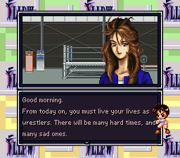
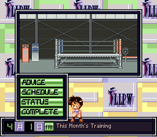
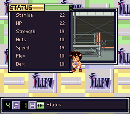
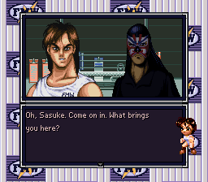
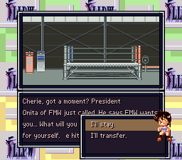
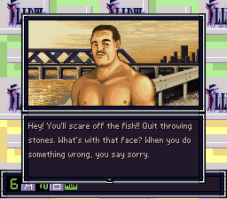
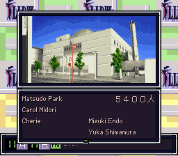
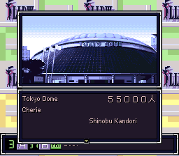

# Screenshots

Shiroi Rinngu He - Twinkle Little Star Story with the English patch, taken in Mesen 2.

## The opening

President Rumi Kazama's first-morning speech to the new trainees. Story text is drawn by a new variable-width renderer.

## The month menu

Advice, schedule, status: the menus are translated in place.

## Status

The stat names follow the guide: HP, Strength, Guts, Speed, Flex, Dex.

## The FMW route

Atsushi Onita and the Great Sasuke.

## Choices

Onita's offer to join FMW, one of the choices that set your route.

## Real wrestlers

Yoshiaki Fujiwara, met by chance on the Kurenai route.

## Match cards

Every booked match: venue, attendance and both corners.

## The Tokyo Dome

March 31, 2000: the final against Shinobu Kandori.
